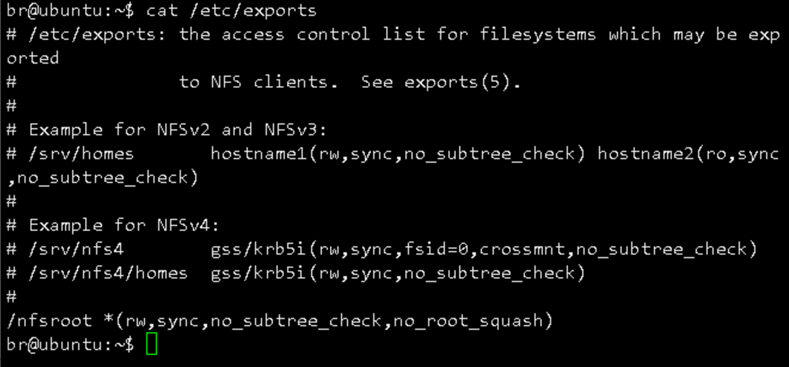

# STM32MP157: Compile the kernel and device tree, and debug 'prefetch abort'.

> **Date :** 2026-10-21 UTC+8 22:59\
> **Development Board :** STM32MP157AAC based on DongShan Wei\
> **System Environment :** Windows10 22H2 Host , VMware Workstation17 , Linux-5.4\
> **Current State :** Solved

**The core of the malfunction lies in the incorrect writing of the uImage loading address. The article does not discuss this fundamental error. Instead aims to troubleshoot the 'prefetch abort' issue encountered in the kernel, providing a beginner's perspective on understanding and learning embedded Linux. This will enable readers to quickly analyze and locate faults, and expand their knowledge to avoid falling into pitfalls again. All commands for the development board are executed through the serial port.**

## 1. ‌Fault Background and Symptom

### 1.1 Operation Objective

自行编译 Linux 内核与设备树，替换板载 eMMC 中的原厂内核镜像，验证内核编译结果，为后续驱动开发做准备。

### 1.2 Experimental Environment

| 层级 | 设备/系统 | IP地址 | 说明 |
|------|-----------|--------|------|
| 宿主机 | Windows 10 22H2 | 192.168.145.127 | 运行VMware与串口工具 |
| 虚拟机 | Ubuntu 22.04.5 | 192.168.145.128 | 交叉编译、NFS服务、TFTP服务 |
| 开发板 | Buildroot + Linux 5.4 | 192.168.145.129 | eMMC本地启动，串口调试 |

### 1.3 Reproduction Steps

1. 检查挂载文件夹权限 
   
   ```sh
   cat /etc/exports 
   ```

    
    `/nfsroot *(rw,sync,no_subtree_check,no_root_squash)` 
    \* 允许任意IP，rw读写权限，sync同步写入，no_root_squash保留root用户权限。同时设置目录权限 `sudo chmod 777 /nfsroot` 并执行 `sudo exportfs -arv` 生效。

2. 在开发板将Ubuntu的/nfsroot挂载到/mnt
   
    ```sh
    mount -t nfs -o nolock,vers=3 192.168.145.128:/nfsroot /mnt
    ``` 

3. 编译内核配置文件、设备树
   
    ```sh 
    cd 100ask_stm32mp157_pro-sdk/Linux-5.4 #（内核源码目录）
    make 100ask_stm32mp157_pro_defconfig
    make uImage LOADADDR=0xC200040 -j4 
    # 加载地址(Load Address)这里正确地址应该为0xC2000040，地址错误是出现故障的根本原因，而编译程序不会在此报错！
    make dtbs 
    # 编译完成后，在arch/arm/boot生成uImage文件；在arch/arm/boot/dts生成设备树二进制文件stm32mp157c-100ask-512d-v1.dtb
    ```

4. 复制编译产物uImage和stm32mp157c-100ask-512d-v1.dtb到/nfsroot
5. 进入内核源码目录，编译内核模块
   
    ```sh
    make ARCH=arm CROSS_COMPILE=arm-buildroot-linux-gnueabihf- modules -j4
    ```

6. 在开发板将磁盘分区挂载到/boot
   
    ```sh
    mount /dev/mmcblk2p2 /boot
    ```

7. 替换板载内核与模块
   
    ```sh
    cp /mnt/uImage /boot
    cp /mnt/stm32mp157c-100ask-512d-v1.dtb /boot
    cp /mnt/lib/modules -rf /lib
    ```

8.  同步并重启
    
    ```sh
    sync
    reboot
    ```

### 1.4 Fault Phenomenon

1. 执行`cp /mnt/lib/modules -rf /lib`时内存耗尽，NFS一边持续收大包、一边往SD卡写，512M内存太小，NFS接收skb分配失败，只要走NFS读取大量小文件，就容易触发这个报错。
    >- 作为初学者，NFS根文件系统启动是值得进一步学习的，SD卡拷贝是固化方式。此处采用手动分批量复制子目录的方式。
    >- 韦东山在后续采用了安卓调试桥(Android Debug Bridge,ADB)完成复制；写驱动优先NFS rootfs，写上层应用、测试小demo用adb push
2.  `reboot`卡住，尝试卸载/mnt并重启时发生故障
    > Starting kernel ...
    > prefetch abort
    > pc : [<0c20003c>]
    > ...
    > Resetting CPU ...
    >resetting ...

    崩溃发生在 `Starting kernel ...` 之后瞬间，系统反复复位，无法进入根文件系统，这是本次故障的核心问题。

## 2. Debugging

### 2.1 Preliminary Elimination: Kernel Modules Do Not Affect the Boot Stage
**思路：** 先划定故障发生的阶段，缩小排查范围。
`/lib/modules` 目录下的驱动模块，仅在内核启动完成、挂载根文件系统之后才会被加载。而故障发生在 `Starting kernel ...` 瞬间，此时内核刚解压、尚未挂载根文件系统，完全不会读取模块文件。
**结论：** 本次启动崩溃与拷贝内核模块无关，问题集中在 uImage 内核镜像、dtb 设备树、启动地址、硬件固件兼容性四个方向。

### 2.2 Verify Boot Partition: Rule Out File Corruption
**思路：** 异常断电容易导致FAT格式的boot分区文件损坏，先验证文件完整性。进入U-Boot交互界面（上电倒计时按空格），执行如下命令

```bash
>Press SPACE to abort autoboot in 1 seconds
STM32MP> mmc dev 1
switch to partitions #0, OK
mmc1(part 0) is current device
STM32MP> fatls mmc 1:2
73271   stm32mp157c-100ask-512d-v1.dtb
2854   boot.scr.uimg
74438   stm32mp157c-100ask-512d-lcd-v1.dtb
108418   stm32mp157c-100ask-512d-hdmi-v1.dtb
8171336   uImage
mmc1_extlinux/
mmc0_extlinux/
3632283   uInitrd
46180   splash.bmp
7 file(s), 2 dir(s)
# 正常列出所有文件，包括 uImage、dtb、boot.scr.uimg、uInitrd 等，说明分区表与文件结构完好。
# 继续加载内核到内存，验证可读性
STM32MP> fatload mmc 1:2 0xc2000000 uImage
8171336 bytes read in 316 ms (24.7 MiB/s)
# 文件完整读取，U-Boot 校验和通过。
```

**结论：** boot 分区未损坏，内核文件本身可读、校验和正常，排除文件截断、闪存坏块问题。

#### 2.2.1 Clarification of Common Pitfall: MMC Numbering Inconsistency Between U-Boot and Linux

**思路：** 排查过程中一度混淆 mmc 设备编号，这是 STM32MP 平台高频踩坑点，专门验证确认。执行 `printenv` 与 `mmc dev` 测试：

```bash
mmc dev 2    # 返回 MMC Device 2 not found
mmc dev 1    # 切换成功
mmc part     # 列出ssbl/rootfs1/rootfs2三个分区
```


| 视角 | eMMC 设备名 | boot 分区 | rootfs 分区 |
| --- | --- | --- | --- |
| U-Boot | mmc1 | mmc 1:2 (rootfs1) | mmc 1:3 (rootfs2) |
| Linux 内核 | mmcblk2 | /dev/mmcblk2p2 | /dev/mmcblk2p3 |

**结论：**

- U-Boot 与 Linux 内核的 MMC 控制器枚举顺序不同，编号没有一一对应关系；
- bootargs 中根分区必须写 `/dev/mmcblk2p3`，写错会导致找不到根文件系统；
- 本次 prefetch abort 不是分区号错误导致的（分区错误表现为卡 Waiting for root device，不会直接复位）。

#### 2.2.2 Load Address Probing: Secure Reserved Memory Restrictions

**思路：** 怀疑内核加载地址不对，尝试直接加载到 uImage 头部声明的入口地址。

```bash
fatload mmc 1:2 0xc200040 uImage
** Reading file would overwrite reserved memory **
```

**结论：**`0xc200040` 属于 TF-A/SP_MIN 安全固件的保留内存区域，U-Boot 做了保护，禁止直接写入。正确做法是将 uImage 加载到普通空闲内存（如 `0xc4200000`），`bootm` 命令会自动解析 uImage 头部，将内核搬运到它声明的 Load Address 处，无需手动加载到入口地址。更换到空闲地址加载后，依然启动崩溃，说明不是 U-Boot 加载地址的问题。

### 2.3 eMMC Local Boot

内核、设备树复制到 eMMC 的 boot 分区文件大概率损坏、没刷对，因此让U-Boot 从 eMMC 加载 uImage + dtb，挂载 eMMC 上的 ext4 根文件系统 `/dev/mmcblk2p3`

```bash
STM32MP> printenv           #打印环境
altbootcmd=run bootcmd
arch=arm
autoload=no
boot_targets=mmc1
bootcmd=run bootcmd_stm32mp
bootcmd_android=env set mmc_boot run android_mmc_boot;run bootcmd_stm32mp
bootcmd_mmc0=devnum=0; run mmc_boot
bootcmd_mmc1=devnum=1; run mmc_boot
bootcmd_mmc2=devnum=2; run mmc_boot
ver=U-Boot 2020.01-stm32mp-r1 (Aug 16 2026 - 09:15:35 +0800)
Environment size: 6067/8187 bytes
STM32MP> mmc dev 2          # 进入mmc，读取eMMC里的uImage和dtb
MMC Device 2 not found      # 然而，在U-Boot视角里没有 mmc2
no mmc device at slot 2
STM32MP> mmc part
Card did not respond to voltage select!
```

板子默认扫描mmc1，即板载eMMC,则mmc0一般是 SD 卡插槽。这个U-Boot是STM32MP的distro自动启动模式（extlinux 方式），不是简单手动 fatload 直接 bootm 的老式写法，它不是直接读 uImage，而是去 bootfs 分区找 `extlinux/stm32mp157c-100ask-512d-v1_extlinux.conf`这个配置文件，由这个配置文件指定内核、dtb、bootargs。

> ```bash
> STM32MP> mmc dev 1
> switch to partitions #0, OK
> mmc1(part 0) is current device
> STM32MP> mmc part
> Partition Map for MMC device 1  --   Partition Type: EFI
> Part	Start LBA	End LBA		Name    
> 1	0x00000400	0x000013ff	"ssbl"  
> 2	0x00001400	0x000413ff	"rootfs1"
> 3	0x00041400	0x00747bff	"rootfs2"
> STM32MP> fatls mmc 1:2
> 73271   stm32mp157c-100ask-512d-v1.dtb
> 2854   boot.scr.uimg
> 74438   stm32mp157c-100ask-512d-lcd-v1.dtb
> 108418   stm32mp157c-100ask-512d-hdmi-v1.dtb
> 8171336   uImage
> mmc1_extlinux/
> mmc0_extlinux/
> 3632283   uInitrd
> 46180   splash.bmp
> ```
>> 再次验证mmc dev 1 是eMMC，其中\
> Part 1：ssbl       `TF-A / FIP 安全固件分区`\
> Part 2：rootfs1    `FAT分区，存放 uImage、dtb、boot.scr.uimg、mmc1_extlinux`\
> Part 3：rootfs2    `Linux ext4 根文件系统分区`\
> 至此，当前磁盘分区示意如下图所示（不同固件的设备树编号略有差异，以实际挂载、启动日志为准）
> 
> ```text
> eMMC 存储
> ├── [硬件分区 1] mmcblk2boot0 / mmcblk2boot1 (TF-A 启动, 禁止修改)
> ├── [硬件分区 2] mmcblk2rpmb               (安全重放保护, 开发不管)
> └── [硬件分区 3] mmcblk2                    (用户区主体, 正常操作)
>     ├── mmcblk2p1 (ssbl)    [2MB]       -> U-Boot (SSBL)
>     ├── mmcblk2p2 (rootfs1) [64MB]      -> FAT32, boot 分区 (uImage, dtb等)
>     └── mmcblk2p3 (rootfs2) [剩余空间]   -> ext4, 根文件系统 (系统/驱动/应用)
> ```
> 
> ```bash
> STM32MP> fatload mmc 1:2 0xc200040 uImage
> ** Reading file would overwrite reserved memory **
> STM32MP> fatload mmc 1:2 0xc4000000 stm32mp157c-100ask-512d-v1.dtb
> 73271 bytes read in 41 ms (1.7 MiB/s)
> STM32MP> setenv bootargs 'root=/dev/mmcblk1p3 rootwait rw console=ttySTM0,115200'
> STM32MP> bootm ${kernel_addr_r} - ${fdt_addr_r}
> Wrong Image Format for bootm command
> ERROR: can't get kernel image!
> ```
>> `0xc200040` 这个地址属于 TF-A/SP_MIN 的保留安全内存区域，U-Boot 保护起来了，不允许在这里直接加载文件！这是 STM32MP 信任固件（TF-A）的硬性限制，不能直接往 Entry 地址加载 uImage，于是更换到更高的地址，依旧无效

问题发生时没有检查地址，所以依旧不能定位问题，因此先用原厂自带的内核启动，排除硬件、固件故障

### 2.4 Isolation Verification: Boot with the Original Factory Image

**思路：**之前把 eMMC mmc1:2 分区里面原厂 uImage 覆盖成了你自己编译的版本，现在分区里已经没有原厂内核了，所以自动启动也在跑你这个新内核，一起崩溃。现在从 Ubuntu TFTP 下载一份 SDK 原厂配套 uImage、dtb，放回 mmc1:2，验证启动。

> ```bash
> br@ubuntu:~$ mkimage -l ~/Desktop/Buildroot_2020/uImage #校验内核信息
> Image Name:   Linux-5.4.31
> Created:      Thu Oct 27 19:09:36 2022
> Image Type:   ARM Linux Kernel Image (uncompressed)
> Data Size:    8187608 Bytes = 7995.71 KiB = 7.81 MiB
> Load Address: c2000040
> Entry Point:  c2000040
>```

```bash
setenv ipaddr 192.168.145.129
setenv serverip 192.168.145.128
saveenv # 把 bootargs、bootcmd 写到 eMMC 的 U‑Boot 环境分区
# 保证Ubuntu的/tftpboot有uImage、dtb，然后继续进行。
# 经尝试，开发板当前不支持`fatwrite`命令，因此直接采用TFTP加载内核、dtb启动方式
tftp 0xc4200000 uImage
# fatwrite mmc 1:2 0xc4200000 uImage ${filesize} 
tftp 0xc4000000 stm32mp157c-100ask-512d-v1.dtb
# fatwrite mmc 1:2 0xc4000000 stm32mp157c-100ask-512d-v1.dtb ${filesize}
mmc dev 1
tftp 0xc4200000 uImage 
# Replace 'fatload mmc 1:2 0xc4200000 uImage'
tftp 0xc4000000 stm32mp157c-100ask-512d-v1.dtb 
# Replace 'fatload mmc 1:2 0xc4000000' stm32mp157c-100ask-512d-v1.dtb'
setenv bootargs 'root=/dev/mmcblk2p3 rootwait rw console=ttySTM0,115200'
# 不要写错设备号(mmcblk1p3等)，否则找不到根文件系统
bootm 0xc4200000 - 0xc4000000
```
成功启动，但是大量 `Unknown symbol __stack_chk_guard`，这个是栈保护符号不匹配根文件系统里的 ko 模块（wifi、cec、galcore、led_drv 等）是用开启`STACK_PROTECTOR`的编译器编译的；但是当前这个原版内核镜像编译时没有开启栈保护，内核和模块编译选项不一致会使模块加载失败。

### 2.5 Root Cause Identification: Incorrect LOADADDR Parameter

对比原厂与自制内核的头部信息：

```bash
# 原厂内核
mkimage -l buildroot_2020/uImage
Load Address: c2000040
Entry Point:  c2000040

# 自制内核
mkimage -l sdk/uImage
Load Address: 0c200040
Entry Point:  0c200040
```

**差异：** 自制内核的 LOADADDR 少写了一个 `0`，地址从 `0xC2000040` 变成了 `0x0C200040`，完全偏移到了非法内存区域。
**原理说明：**`LOADADDR` 是内核的链接基地址，编译阶段内核的所有函数地址、跳转指令、符号表全部基于该地址计算。地址错误时，U-Boot 跳转入内核入口后，CPU 取指地址落在 TF-A 安全保留区域或未映射空间，直接触发 ARM 架构的预取指异常（prefetch abort），导致系统复位。

## 3. Improvement and remaining issues

### 3.1 Solidify U-Boot to Enable Power-on eMMC Boot

```bash
eMMC 存储
├── [硬件分区 1] mmcblk2boot0 / mmcblk2boot1 (TF-A 启动, 禁止修改)
├── [硬件分区 2] mmcblk2rpmb               (安全重放保护, 开发不管)
└── [硬件分区 3] mmcblk2                    (用户区主体, 正常操作)
    ├── mmcblk2p1 (ssbl)    [2MB]       -> U-Boot (SSBL)
    ├── mmcblk2p2 (rootfs1) [64MB]      -> FAT32, boot 分区 (uImage, dtb等)
    └── mmcblk2p3 (rootfs2) [剩余空间]   -> ext4, 根文件系统 (系统/驱动/应用)
```

把启动固件、内核、根文件系统分开，旨在安全升级、故障隔离：(1)内核刷坏了，U-Boot 还在，就能用 TFTP 救砖；(2)根文件系统坏了，内核和 U-Boot 正常，就能进急救模式。

```bash
mount /dev/mmcblk2p2 /boot
# 先备份原来的坏内核（可选，建议留底）
mv /boot/uImage /boot/uImage_bad
mv /boot/stm32mp157c-100ask-512d-v1.dtb /boot/stm32mp157c-100ask-512d-v1.dtb_bad
cp /mnt/uImage /boot/
cp /mnt/stm32mp157c-100ask-512d-v1.dtb /boot/
sync
umount /boot
reboot
[26317.848387] nfs: server 192.168.145.128 not responding, still trying # 重启时仍然卡在nfs，理论上已经卸载了/boot，不应该出现
poweroff # 执行关机，成功关机
```
因为已经固化成功，而且不存在地址写入错误，板子再次通电后成功启动。

### 3.2 Legacy Issue: System Hang Caused by NFS Mounting

**现象：** 手动挂载 `/mnt` NFS 目录后，直接执行 `reboot` 会卡在 NFS 等待，而执行 `poweroff` 可以正常下电。

```bash
nfs: server 192.168.145.128 not responding, still trying
```

**原因：** Buildroot 默认关机流程中，网络服务先于文件系统停止；手动挂载的 NFS 没有专属卸载脚本，网卡断开后 NFS 客户端会阻塞等待服务器响应，导致关机流程卡住。`poweroff` 直接触发 PSCI 硬件下电，不等待所有服务优雅退出，因此不会阻塞。
**方案（尚未验证）：** 修改 `/etc/init.d/S40network`，在 `stop` 分支最前端加入强制卸载

```bash
stop)
    umount -f /mnt 2>/dev/null
    printf "Stopping network: "
    ...
```

## 4. Summary

### 4.1 Fault Causes

- **直接原因：** 编译内核时 `LOADADDR` 参数少写一位 `0`（误写为 `0xC200040`，正确值为 `0xC2000040`），导致内核链接基地址完全偏移，落在TF-A安全保留内存区域。U-Boot跳转内核入口后，CPU访问非法地址触发ARM预取指异常，系统直接复位，形成无限启动循环。
- **间接原因：** (1)NFS拷贝阻塞后强制断电，导致boot分区文件状态存疑，增加了排查干扰项；(2)MMC编号迷惑：U-Boot与Linux下MMC设备编号不一致，一度怀疑分区定位错误，拉长了排查路径。

### 4.2 Troubleshooting Methods

**嵌入式启动类故障排查思路**
- **自下而上：** 硬件→固件→U-Boot→内核→根文件系统，逐层排除，不要开始就陷入细节；
- **隔离对照：** 优先使用原厂官方镜像做对照组，快速判断是硬件/固件问题还是镜像问题；
- **信息对比：** 对比正常镜像与故障镜像的头部信息`mkimage -l`，是定位地址类、格式类问题的高效手段。

**prefetch abort 常见原因排查清单**
| 序号 | 可能原因 | 验证方法 |
|------|----------|----------|
| 1 | 内核加载/链接地址错误 | `mkimage -l uImage` 查看Load Address是否匹配平台标准值 |
| 2 | 设备树不匹配、DDR配置错误 | 替换原厂配套dtb测试 |
| 3 | TF-A安全固件与内核版本不兼容 | 整套固件+内核同步升级 |
| 4 | 内核镜像文件损坏 | 校验md5、重新传输镜像 |
| 5 | DDR硬件故障、时序不稳 | 运行原厂压力测试验证硬件 |

### 4.3 Key Knowledge Points

- **STM32MP启动链：** ROM → TF-A(BL2) → SP_MIN(BL32) → U-Boot → Linux，安全固件划分了安全/非安全内存区域，内核只能访问非安全域；
- **MMC编号差异：** U-Boot与Linux内核的MMC设备编号无一一对应关系，必须以实际枚举结果为准，不可想当然套用；
- **FAT分区脆弱性：** eMMC的boot分区为FAT格式，无日志机制，异常断电极易损坏文件，替换内核后务必执行`sync`再重启。

## 5 Appendix

为保证正文阅读流畅，完整操作日志、报错日志、启动日志等统一归档在此附录中，供需要复现问题的读者查阅。

<details>
<summary><b>👉 点击展开/折叠：附录日志及分区图表 (点击查看)</b></summary>

<br>

| 文件名 | 对应场景 |
|--------|----------|
| [InsufficientMemory.bash](logs/InsufficientMemory.bash) | 批量拷贝内核模块触发内存耗尽告警 |
| [CannotReboot.txt](logs/CannotReboot.txt) | NFS挂载导致reboot阻塞、关机卡住 |
| [PrefetchAbort.txt](logs/PrefetchAbort.txt) | 自制内核启动触发prefetch abort、无限复位完整日志 |
| [tftpboot.txt](logs/tftpboot.txt) | 原厂内核TFTP加载、成功启动完整日志 |
